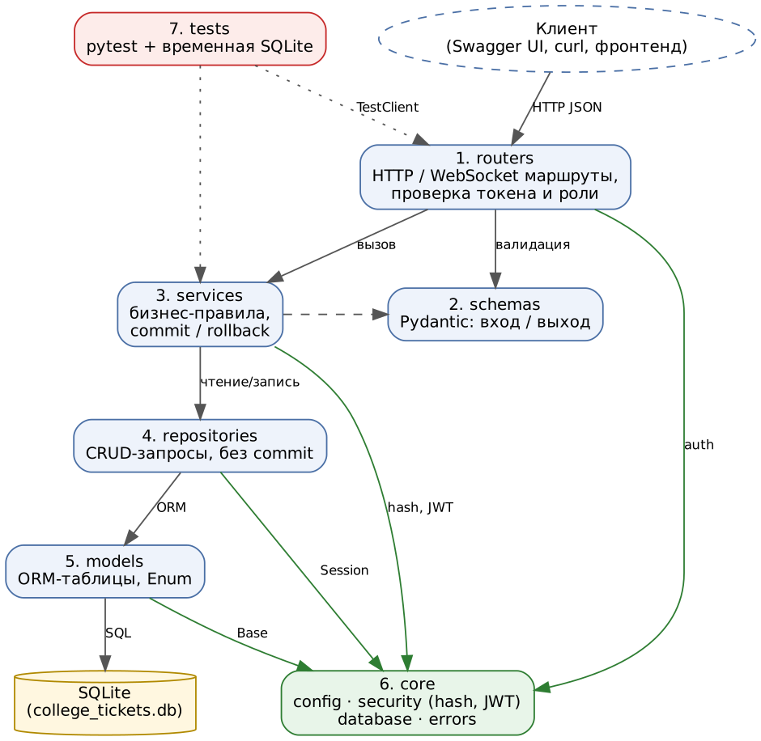
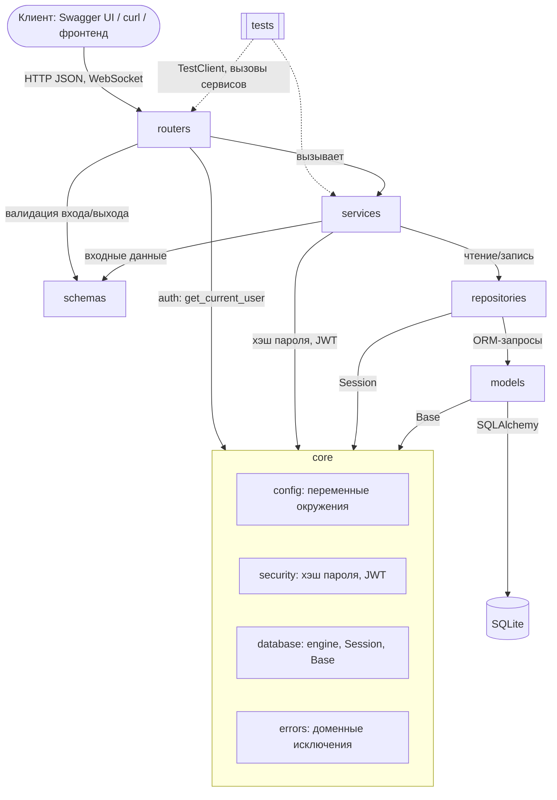

# УП3. Архитектура и модули

Приложение построено по слоям. Запрос идёт строго сверху вниз:

**client → router → service → repository → DB**

Конфигурация (`core/config`) и аутентификация (`core/security`) вынесены в отдельный модуль `core` и не зависят от остальных слоёв.

## Обязанности модулей (по одной фразе)

| № | Модуль | Каталог | Обязанность |
|---|--------|---------|-------------|
| 1 | **routers** | `app/routers/` | Принимают HTTP/WebSocket‑запросы, проверяют токен и роль через зависимости и передают работу сервису. |
| 2 | **schemas** | `app/schemas/` | Описывают и валидируют входные и выходные данные API на Pydantic (без `password_hash` в ответах). |
| 3 | **services** | `app/services/` | Реализуют бизнес‑правила (права, переходы статусов, аудит) и управляют транзакцией: `commit` или `rollback`. |
| 4 | **repositories** | `app/repositories/` | Выполняют CRUD‑запросы SQLAlchemy к одной сущности, не зная о HTTP и не делая `commit`. |
| 5 | **models** | `app/models/` | Объявляют ORM‑таблицы, связи, ограничения и перечисления ролей и статусов. |
| 6 | **core** | `app/core/` | Хранит общую инфраструктуру: настройки из окружения, подключение к БД, хэширование паролей, JWT и доменные ошибки. |
| 7 | **tests** | `tests/` | Автоматически проверяют критерии приёмки на временной SQLite, не обращаясь к сети. |

## Правила зависимостей

| Модуль | Может импортировать | Не может импортировать |
|--------|--------------------|------------------------|
| routers | services, schemas, core, models (только Enum) | repositories напрямую |
| services | repositories, schemas, models, core | routers, `fastapi` |
| repositories | models, core | services, routers, schemas, `fastapi` |
| schemas | models (только Enum) | services, repositories, routers |
| models | core.database | всё остальное |
| core | только стандартную библиотеку и внешние пакеты | любые слои `app.*` (кроме своих подмодулей) |
| tests | всё | — |

Граф зависимостей **ацикличен**: каждая стрелка идёт от верхнего слоя к нижнему, `core` — лист графа. Начиная с УП6 это проверяется автоматическим тестом `tests/test_architecture.py`: он разбирает импорты (модуль `ast`) и падает, если, например, репозиторий импортирует `fastapi` или сервис импортирует роутер.

## Отдельные auth и config

* `core/config.py` — единственное место чтения переменных окружения (`APP_ENV`, `DATABASE_URL`, `SECRET_KEY`, `ACCESS_TOKEN_EXPIRE_MINUTES`). Остальной код получает настройки через `get_settings()`.
* `core/security.py` — хэширование (`hash_password` / `verify_password`, алгоритм scrypt) и выпуск/проверка JWT (`create_access_token` / `decode_access_token`). Не зависит от FastAPI.
* `routers/deps.py` — FastAPI‑зависимости `get_db`, `get_current_user`, `require_roles(...)`: тонкая обёртка, которая связывает HTTP‑заголовок `Authorization` с `core/security` и репозиторием пользователей.

## Путь запроса на примере `POST /auth/register`

1. **router** `auth.register` получает JSON, FastAPI валидирует его схемой `UserRegister`.
2. **service** `AuthService.register` проверяет уникальность email, хэширует пароль (`core.security`), открывает транзакцию.
3. **repository** `UserRepository.add` добавляет объект `User` в сессию и делает `flush`.
4. **service** выполняет `commit` (при исключении — `rollback`) и возвращает ORM‑объект.
5. **router** сериализует его схемой `UserRead` (без `password_hash`) и отвечает `201`.
