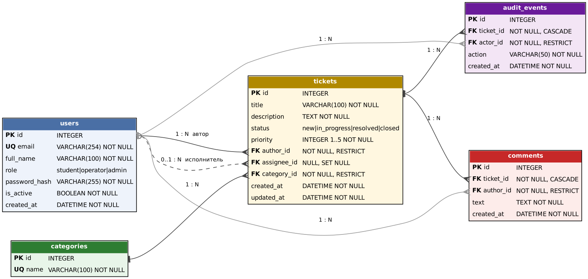
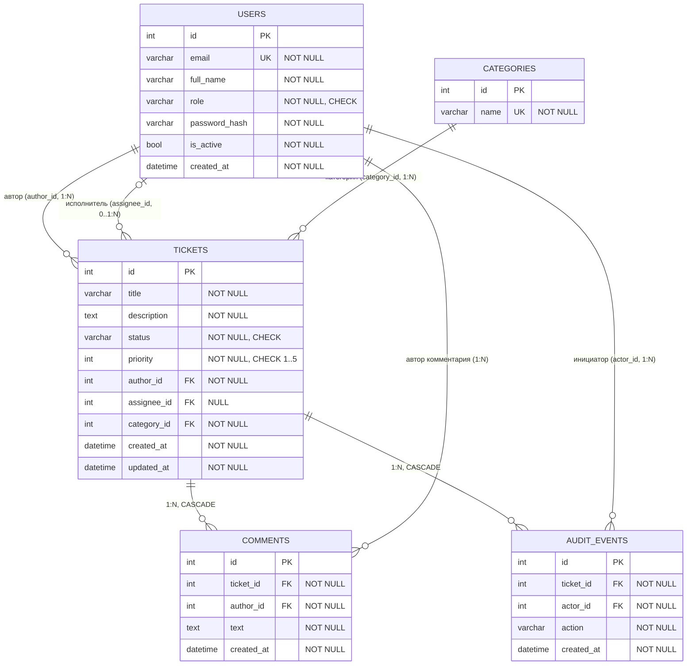

# УП4. Модель данных

СУБД — SQLite (файл `college_tickets.db`). Внешние ключи включаются для каждого соединения (`PRAGMA foreign_keys=ON`), иначе SQLite их не проверяет. Схема создаётся только миграциями Alembic.

## Связи и кратность

| Связь | Кратность | FK | NULL | При удалении родителя |
|-------|-----------|----|------|-----------------------|
| User (автор) — Ticket | 1 : N (у заявки ровно один автор, у пользователя 0..N заявок) | `tickets.author_id → users.id` | нет | `RESTRICT` — нельзя удалить пользователя, у которого есть заявки (пользователей деактивируют через `is_active=false`) |
| User (исполнитель) — Ticket | 0..1 : N (у заявки не более одного исполнителя) | `tickets.assignee_id → users.id` | **да** | `SET NULL` — заявка остаётся, исполнитель снимается |
| Category — Ticket | 1 : N | `tickets.category_id → categories.id` | нет | `RESTRICT` — категорию с заявками удалить нельзя (API вернёт 409) |
| Ticket — Comment | 1 : N | `comments.ticket_id → tickets.id` | нет | `CASCADE` — комментарии удаляются вместе с заявкой |
| Ticket — AuditEvent | 1 : N | `audit_events.ticket_id → tickets.id` | нет | `CASCADE` — журнал удаляется вместе с заявкой |
| User — Comment | 1 : N | `comments.author_id → users.id` | нет | `RESTRICT` |
| User — AuditEvent | 1 : N | `audit_events.actor_id → users.id` | нет | `RESTRICT` |

## Словарь данных

### users — пользователи

| Поле | Тип | NULL | Ограничения | Описание |
|------|-----|------|-------------|----------|
| id | INTEGER | нет | **PK**, автоинкремент | Идентификатор |
| email | VARCHAR(254) | нет | **UNIQUE** — уникальный индекс `ix_users_email` | Логин, хранится в нижнем регистре |
| full_name | VARCHAR(100) | нет | длина 2–100 (проверка в схеме) | ФИО |
| role | VARCHAR(20) | нет | CHECK ∈ {`student`, `operator`, `admin`}; по умолчанию `student` | Роль |
| password_hash | VARCHAR(255) | нет | — | Стойкий хэш scrypt с солью: `scrypt$n$r$p$salt$hash`. Открытый пароль не хранится |
| is_active | BOOLEAN | нет | по умолчанию `true` | Неактивный пользователь не может войти |
| created_at | DATETIME (UTC) | нет | по умолчанию — текущее время | Дата регистрации |

### categories — категории заявок

| Поле | Тип | NULL | Ограничения | Описание |
|------|-----|------|-------------|----------|
| id | INTEGER | нет | **PK** | Идентификатор |
| name | VARCHAR(100) | нет | **UNIQUE** (`uq_categories_name`) | Название. Начальные значения (миграция): «IT», «Учебный процесс», «Хозяйственная часть» |

### tickets — заявки

| Поле | Тип | NULL | Ограничения | Описание |
|------|-----|------|-------------|----------|
| id | INTEGER | нет | **PK** | Идентификатор |
| title | VARCHAR(100) | нет | длина 3–100 | Тема |
| description | TEXT | нет | длина 1–2000 | Описание проблемы |
| status | VARCHAR(20) | нет | CHECK ∈ {`new`, `in_progress`, `resolved`, `closed`}; по умолчанию `new`; индекс | Статус |
| priority | INTEGER | нет | CHECK `priority BETWEEN 1 AND 5`; по умолчанию 3 | Приоритет (1 — низкий, 5 — критичный) |
| author_id | INTEGER | **нет** | **FK** → users.id, `ON DELETE RESTRICT`, индекс | Студент‑автор |
| assignee_id | INTEGER | **да** | **FK** → users.id, `ON DELETE SET NULL`, индекс | Назначенный оператор |
| category_id | INTEGER | нет | **FK** → categories.id, `ON DELETE RESTRICT`, индекс | Категория |
| created_at | DATETIME (UTC) | нет | по умолчанию — текущее время | Создана |
| updated_at | DATETIME (UTC) | нет | обновляется при каждом изменении | Изменена |

### comments — комментарии

| Поле | Тип | NULL | Ограничения | Описание |
|------|-----|------|-------------|----------|
| id | INTEGER | нет | **PK** | Идентификатор |
| ticket_id | INTEGER | нет | **FK** → tickets.id, `ON DELETE CASCADE`, индекс | Заявка |
| author_id | INTEGER | нет | **FK** → users.id, `ON DELETE RESTRICT` | Автор комментария |
| text | TEXT | нет | длина 1–1000 | Текст |
| created_at | DATETIME (UTC) | нет | по умолчанию — текущее время | Создан |

### audit_events — журнал аудита

| Поле | Тип | NULL | Ограничения | Описание |
|------|-----|------|-------------|----------|
| id | INTEGER | нет | **PK** | Идентификатор |
| ticket_id | INTEGER | нет | **FK** → tickets.id, `ON DELETE CASCADE`, индекс | Заявка |
| actor_id | INTEGER | нет | **FK** → users.id, `ON DELETE RESTRICT` | Кто выполнил действие |
| action | VARCHAR(50) | нет | одно из: `ticket_created`, `assigned`, `status_changed`, `commented` | Тип события; история заявки восстанавливается по событиям, упорядоченным по `created_at` |
| created_at | DATETIME (UTC) | нет | по умолчанию — текущее время | Время события |

## Перечисления

| Enum | Значения | Где используется |
|------|----------|------------------|
| `UserRole` | `student`, `operator`, `admin` | `users.role` |
| `TicketStatus` | `new`, `in_progress`, `resolved`, `closed` | `tickets.status` |
| `AuditAction` | `ticket_created`, `assigned`, `status_changed`, `commented` | `audit_events.action` |

Допустимые переходы статусов: `new → in_progress → resolved → closed`. Переход назад или через шаг запрещён (409 `invalid_transition`).
